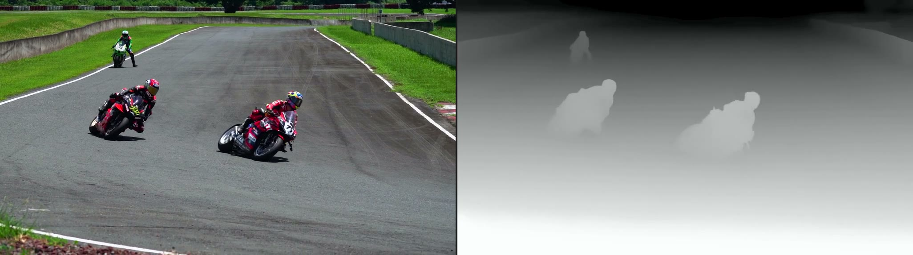
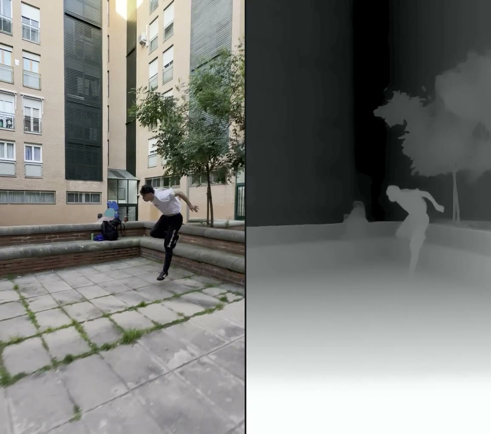

# LiteDepth

[English](README.md) | 简体中文

[](#)
[](LICENSE)
[](#)

一个轻量、无需独立显卡即可在本地运行的深度视频生成工具。

传统单目深度估计方案通常需要配置复杂的 Python 环境、PyTorch 及 NVIDIA CUDA 驱动。LiteDepth 将推理引擎与模型权重直接打包进单一原生二进制程序中，让你在普通的笔记本或服务器上，通过一行命令即可将普通视频转换为连贯平滑的灰度深度视频。

<p align="center">
  
  
</p>

查看完整动态视频对比，请访问 [在线演示站](https://akacoder.github.io/LiteDepth/)。

---

## ✨ 核心特性

- 🖥️ **纯 CPU 运行**：完全无需独立显卡或 CUDA 驱动，普通笔记本与服务器均可高效运行。
- 📦 **单二进制零依赖**：Depth Anything V2 Small 权重与 ONNX Runtime 直接内嵌于可执行文件中，彻底告别 Python / pip 环境配置。
- 🎞️ **连贯抗闪烁**：内置多阶段时序平滑与色调映射，有效抑制单帧单目估计中常见的画面闪烁与边缘抖动。

---

## 🚀 下载与安装

### 预编译版本（推荐）

直接从 GitHub Releases 下载适用于当前平台的单文件二进制程序，赋予执行权限后即可直接运行：

| 系统 / 架构 | 发布文件名 |
| --- | --- |
| **macOS** (Apple Silicon) | `litedepth-darwin-arm64` |
| **Linux** (x86_64) | `litedepth-linux-amd64` |
| **Linux** (ARM64) | `litedepth-linux-arm64` |
| **Windows** (x86_64) | `litedepth-windows-amd64.exe` |

*发布文件名保持固定，便于在脚本或自动化工作流中通过稳定直链下载最新构建。*

> **macOS 兼容性说明**：预编译版本目前仅支持 Apple Silicon 架构。由于上游 ONNX Runtime 自 1.24 版本起已停止提供 Intel（x86_64）macOS 官方预编译库，故不再提供对应构建。

> **外部依赖**：LiteDepth 依赖 `ffmpeg` 与 `ffprobe` 进行音视频编解码与处理。若系统 `PATH` 中未找到它们，在交互式终端中运行 LiteDepth 时，程序会提示自动下载校验过的免安装静态二进制文件至 `~/.litedepth/bin/`。

---

## 💡 快速上手

**导出整段深度视频**：
```bash
./litedepth clip.mp4
```
在视频同级目录下生成 `clip.depth.mp4`。画面呈现近亮远暗效果（0–255 灰度值），画面长边自动限制在 1024 像素以内，同时严格保留原片音轨与帧率。

**生成并排预览对比图**：
```bash
./litedepth --preview clip.mp4
```
在视频全长中均匀抽取关键帧，生成左侧原片、右侧深度的并排对照长图 `clip.depth.preview.jpg`，并自动调用系统默认查看器打开（默认采样 3 帧）。

**仅截取前几秒处理**：
```bash
./litedepth --duration 5 clip.mp4
```
仅处理视频前 5 秒内容，便于快速观察深度质量与运动连贯性。

**处理成片中的一段**：
```bash
./litedepth --start 8 --end 12 clip.mp4
```
窗口是半开区间：含起点、不含终点。`--start 8 --duration 4` 是同一段四秒。音轨取自这段窗口，而不是从文件开头截取。

**用半长边先看一段**：
```bash
./litedepth --scale 512 --preview --start 8 --end 12 clip.mp4
```
`--scale` 只接受 `512` 或 `1024`，默认仍是 1024。512 会跳过宽画面的分块推理，短预览会更快回来。深度网络的输入仍是 518。

**同时写出白模**：
```bash
./litedepth --clay --duration 3 clip.mp4
```
深度视频保持不变。旁边再写出 `clip.depth.clay.mp4`，用色调映射之前的深度着成近亮远暗的白模，时间窗和音轨与这段一致。加上 `--preview` 时，原来的深度对照长图不变，另写一张 `clip.depth.clay.preview.jpg`。

**写出任务说明**：
```bash
./litedepth --manifest clip.mp4
```
在旁边写出 `clip.depth.manifest.json`，里面是时间窗、帧尺寸、输出路径和一段提示词草稿。创作内容留空。加上 `--clay` 时，说明里会写上白模视频。

**先在原片上检查切点**：
```bash
./litedepth --shot-check --scale 512 clip.mp4
```
写出 `clip.shots/`，每个镜头一段重新编码的原片，长边用你设的缩放，旁边有 `index.json`。不写深度视频。短镜头会保留，方便看到每一处切点。加上 `--hls` 时，再写出 `playlist.m3u8` 和传输流切片。用 VLC 打开这个播放列表，镜头会作为一条流连着播。

**再按同样的切点切开深度视频**：
```bash
./litedepth --shots --scale 512 clip.mp4
```
整段深度视频保持不变。`clip.depth.shots/` 里是每个镜头的深度 mp4。切点在原片上计算，再套到已经生成的深度帧上。加上 `--hls` 时，在这些 mp4 旁边再写出 `playlist.m3u8` 和传输流切片。用 VLC 打开这个播放列表，镜头会作为一条流连着播。加上 `--clay` 时，每个镜头另有 `001.clay.mp4`。加上 `--manifest` 时，说明升为 version 2，并列出这些文件。`--shots` 不能和 `--preview` 一起使用，`--shot-check` 不能和深度导出一起使用。`--hls` 需要和 `--shots` 或 `--shot-check` 一起使用。

**按 Seedance 2.5 参考视频来适配**：
```bash
./litedepth --seedance clip.mp4
./litedepth --shots --seedance --scale 512 clip.mp4
```
`--seedance` 把深度视频，以及要求写出的白模，收进 Seedance 2.5 的参考限制：每段 2–30 秒，最多 10 段，合计不超过 30 秒，宽高比在 0.4 到 2.5 之间，边长和像素量落在区间内，帧率 24 到 60，音频为 AAC 或 MP3，文件不超过 200 MB。不带 `--shots` 时，这份适配结果就是深度视频本身。窗口长于 30 秒时只留开头 30 秒。短于 2 秒时先向后补画面，仍不够再向前补；原片本身仍不够，就把这一段放慢到 2 秒。打开这个参数时，`--scale 512` 会升到刚好合法的最小帧尺寸。带上 `--shots` 时，整段深度视频和 `clip.depth.shots/` 仍按你设的缩放写出，`clip.depth.seedance/` 才是适配后的上传那一份。短于 2 秒的镜头并进下一段；最后一段太短时并进上一段。这个合并只发生在上传那一份里。`--seedance` 不能和 `--preview` 或 `--shot-check` 一起使用。

**把深度和原片并排看**：
```bash
./litedepth --compare --start 8 --end 12 --scale 512 clip.mp4
```
深度视频照旧写出。旁边再写出 `clip.depth.compare.mp4`，左边是原片、右边是深度，时间窗和音轨与这段一致，写完后打开。`--compare` 不能和 `--preview` 一起使用。

> **性能提示**：纯 CPU 单目深度估计属于计算密集型任务，处理数秒视频通常耗时数分钟。建议在完整导出长视频前，先使用 `--preview` 或 `--duration` 预览确认效果。

---

## ⚙️ 命令行选项

| 参数 | 说明 |
| --- | --- |
| `--preview` | 生成并自动打开左/右并排的关键帧对照图（默认 3 组对比帧）。 |
| `--preview-frames <N>` | 指定预览采样的帧数（1–12 帧；传入该参数将自动启用预览模式）。 |
| `--start <秒>` | 窗口起点，含该时刻。不写则从成片开头算起。 |
| `--end <秒>` | 窗口终点，不含该时刻。超过成片时长时截到成片结尾。不能和 `--duration` 同时使用。 |
| `--duration <秒>` | 窗口长度。不写 `--start` 时就是开头 N 秒。 |
| `--scale <像素>` | 抽帧长边，只能是 `512` 或 `1024`。默认 `1024`。预览和成片共用这一个值。 |
| `--compare` | 在深度视频旁边再写出左右并排的 mp4 并打开。左边是原片，右边是深度。 |
| `--clay` | 用色调映射之前的深度再写出白模视频；预览时则另写一张白模对照长图。 |
| `--manifest` | 额外写出这次运行的 JSON 说明和提示词草稿。 |
| `--shot-check` | 按镜头切点切开原片并重新编码，用来检查切点。不写深度视频。 |
| `--shots` | 按同样的切点切开深度视频。整段深度视频保持原样。 |
| `--hls` | 和 `--shots` 或 `--shot-check` 一起使用时，额外写出 HLS 播放列表和传输流切片，让 VLC 把这些镜头连成一条流。 |
| `--seedance` | 按 Seedance 2.5 参考视频限制调整深度视频。不带 `--shots` 时，这份结果就是深度视频本身，512 长边过小时会被升高。和 `--shots` 一起用时，整段成片保持原样，适配结果写在 `clip.depth.seedance/`。 |
| `--frames` | 导出视频的同时，将单帧深度图以 PNG 序列保存在视频同级目录下（启用 `--preview` 时此项被忽略）。 |
| `--output <路径>` | 自定义输出的视频或预览图片的目标路径。 |

**切换界面语言**：
```bash
./litedepth setup
```
选择终端界面的交互提示语言（English / 简体中文）。配置保存在 `~/.litedepth/config.json` 中；若未设置，LiteDepth 会自动跟随当前系统语言。

---

## 🛠️ 从源码构建

### 环境要求

1. **Go 1.25+**
2. **C 编译器**（CGO 依赖）：
   - macOS：Xcode 命令行工具（`xcode-select --install`）
   - Linux：`gcc`
   - Windows：MinGW-w64 `gcc`（需加入系统 `PATH`）
3. **FFmpeg & FFprobe**

### 构建步骤

```bash
# 1. 下载内嵌模型权重以及对应平台的 ONNX Runtime 运行库
go run ./scripts/fetchdeps

# 2. 编译
go build -o litedepth ./cmd/litedepth
# Windows：
# go build -o litedepth.exe ./cmd/litedepth
```

---

## 📜 技术栈与致谢

- 模型架构：[Depth Anything V2 Small](https://github.com/DepthAnything/Depth-Anything-V2)
- 推理引擎：[ONNX Runtime](https://onnxruntime.ai/)（通过 [onnxruntime_go](https://github.com/yalue/onnxruntime_go) 提供 CGO 绑定）
- 音视频处理：[FFmpeg](https://ffmpeg.org/)

## 📄 开源协议

本项目基于 [Apache-2.0](LICENSE) 协议开源。
